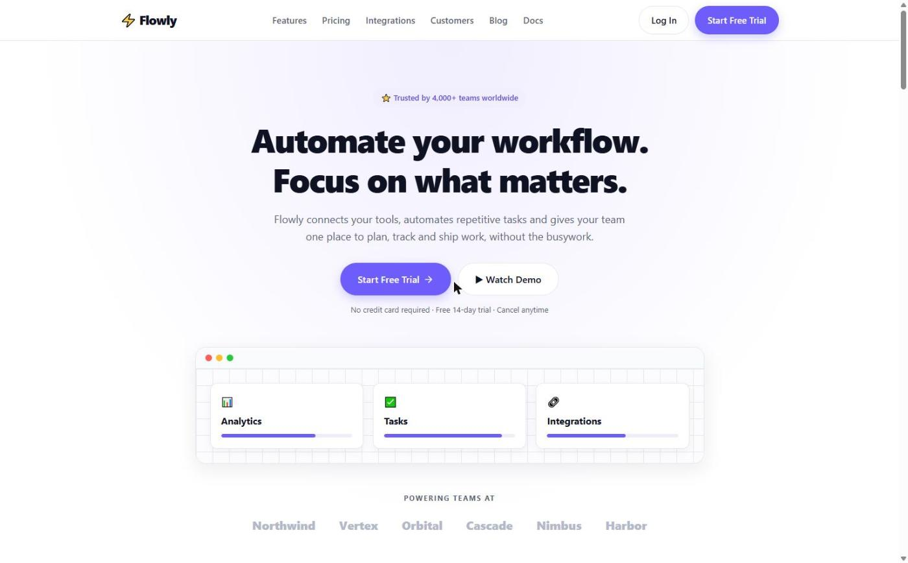

# Flowly - Multi-page SaaS Startup Website Template

A free, responsive SaaS website built with plain HTML5, CSS3 and JavaScript. No frameworks, no build step. It has the pages a software company needs: pricing with a billing toggle, features, integrations, customers, blog, docs, changelog, sign up and more.



**[Live demo](https://lenivalestevao.github.io/saas-startup-landing-page/)**

## Pages

All pages run in a single `index.html` and are routed with the URL hash (for example `#/pricing`), so it works on any static host such as GitHub Pages.

| Page | Route | What it does |
| --- | --- | --- |
| Home | `#/` | Hero, logos, features, animated stats, automation, integrations, pricing, customer and case-study carousels, FAQ, call to action |
| Features | `#/features` | Full feature grid with analytics and security sections |
| Pricing | `#/pricing` | Monthly and annual toggle (saves 20%), plan cards, comparison table, billing FAQ |
| Integrations | `#/integrations` | Searchable, filterable app directory |
| Customers | `#/customers` | Case studies and a testimonials carousel |
| Blog | `#/blog` and `#/blog/1` | Post list with category filter, article pages, newsletter box |
| Docs | `#/docs` and `#/docs/api` | Sidebar navigation, code blocks and previous/next links |
| Changelog | `#/changelog` | Release timeline |
| About, Contact, Help Center | `#/about` `#/contact` `#/faq` | Company page, contact form and grouped FAQ |
| Log in, Sign up | `#/login` `#/signup` | Demo auth forms with a plan picker and a welcome page |
| Privacy, Terms | `#/privacy` `#/terms` | Sample legal pages |
| 404 | any unknown route | Friendly not-found page |

It also includes a mobile off-canvas menu and toast messages.

## Structure

```
index.html   # page shell: header and footer
style.css    # all styles, responsive down to small phones
script.js    # router, pages, demo data, pricing toggle, filters, forms
```

## Customize

- **Colors:** change the CSS variables in `:root` at the top of `style.css` (the brand color is `--primary`).
- **Plans, features, integrations, posts and docs:** edit the arrays at the top of `script.js` (`PLANS`, `FEATURES`, `INTEGRATIONS`, `POSTS`, `DOCS`, `CHANGELOG`).
- **Brand and text:** replace "Flowly" in `index.html` and the copy inside the page functions in `script.js`.

The billing choice and the demo sign-up are kept in `localStorage`. The log in, sign up and contact forms are demos only, so add a real back end before going live.

## License

MIT
